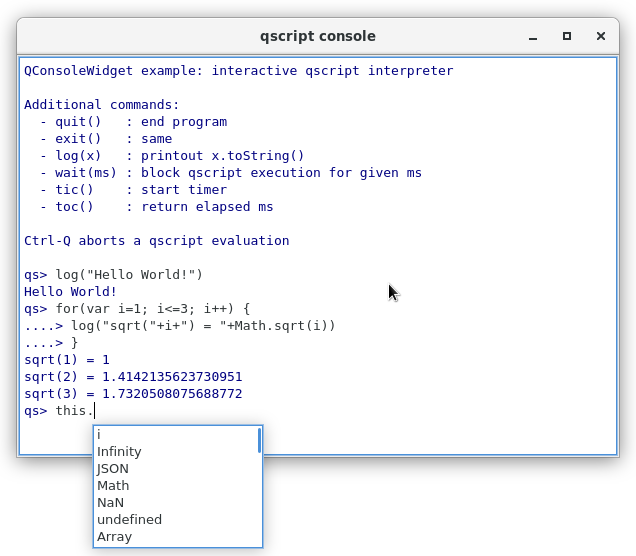

# QConsoleWidget

> part of **QDaq** (https://gitlab.com/qdaq/qdaq) - Qt-based Data Acquisition

A lightweight Qt console widget based on QPlainTextEdit.

It can be used as an interactive scripting terminal or a log window.
Features include standard console-like editing, command history, 
formatted input, output & error streams.

TODO: syntax highlighting

## Usage

Instantiate the widget and set it to input mode. Connect a QObject slot
to the `sigOnConsoleCommand` signal to receive the user input.

```c++
QConsoleWidget w;
w.write(QStringLiteral("enter command> "));
w.setMode(QConsoleWidget::Input);
QObject::connect(&w, &QConsoleWidget::sigOnConsoleCommand, myObject,
                 &MyQObject::evalCommand);
...
void MyQObject::evalCommand(const QString &code)
{
    ...
}
```

## Example

The included example implements a graphical scripting console for QtScript.



